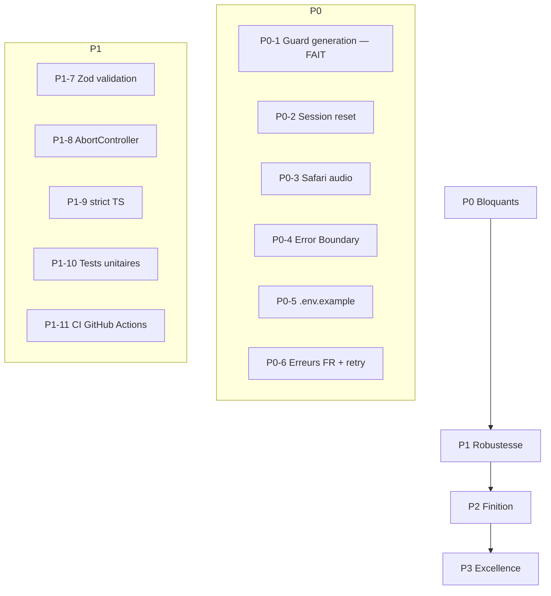

# Feuille de route — Coach Darija IA (front-end)

Document de suivi de la mise en production du front-end, structuré par priorité (P0 → P3).
Dernière mise à jour : juillet 2026.

---

## État actuel

### Ce qui est en place

- [x] Parcours wizard complet (étapes 0 → 4) : accueil → thème → mots → texte → audio → feedback
- [x] Architecture par features (`generation`, `feedback`, `audio-recorder`, `selection`)
- [x] Couche API centralisée (`apiClient`, `ApiError`, `AbortSignal` supporté)
- [x] Guard `handleTextGeneration` corrigé (return early) — `src/App.tsx`
- [x] `.env` ignoré par Git — `.gitignore`
- [x] Responsive CSS (breakpoint 1024px)
- [x] Composant feedback avec scores, barres de progression et attributs `aria-*`
- [x] Cleanup audio (révocation blob URL, arrêt des pistes micro)


### Ce qui reste à faire

Tout le contenu des phases P0 à P3 ci-dessous, sauf l'item P0-1 déjà coché.

---


## Matrice de maturité


| Domaine                  | Score | Commentaire                                      |
| ------------------------ | ----- | ------------------------------------------------ |
| Fonctionnalité core      | 80 %  | Parcours OK, fin de session manquante            |
| Robustesse erreurs       | 30 %  | Base API OK, pas de boundary / retry / timeout   |
| Compatibilité navigateur | 40 %  | Safari / iOS à risque (`audio/webm` codé en dur) |
| Accessibilité            | 50 %  | Bases présentes, lacunes sur live regions        |
| Tests                    | 0 %   | Aucun test unitaire ni E2E                       |
| CI/CD & qualité          | 20 %  | ESLint seulement                                 |
| Documentation            | 10 %  | README = template Vite par défaut                |
| Production-ready         | 20 %  |                                                  |


---


## P0 — Bloquants avant production

Minimum requis pour une mise en prod fiable. Effort estimé : **1–2 jours**.


| #    | Tâche                                        | Fichiers concernés                                                         | Statut   |
| ---- | -------------------------------------------- | -------------------------------------------------------------------------- | -------- |
| P0-1 | Guard génération de texte                    | `src/App.tsx`                                                              | **Fait** |
| P0-2 | Reset session + bouton « Recommencer »       | `src/App.tsx`, `useTextGeneration.ts`, `useFeedbackGeneration.ts`          | À faire  |
| P0-3 | Audio multi-navigateur (Safari / iOS)        | `getSupportedMimeType.ts`, `AudioRecorder.tsx`, `useFeedbackGeneration.ts` | À faire  |
| P0-4 | Error Boundary + écran config `VITE_API_URL` | `ErrorBoundary.tsx`, `ConfigError.tsx`, `src/main.tsx`                     | À faire  |
| P0-5 | `.env.example` + README setup                | `.env.example`, `README.md`                                                | À faire  |
| P0-6 | Erreurs FR + bouton « Réessayer »            | `mapApiError.ts`, `ErrorMessage.tsx`, hooks, `App.css`                     | À faire  |


### Checklist détaillée

- [x] **P0-1 — Guard génération texte**
  - Return early si `!selectedTheme || selectedWords.length === 0`
  - Impossible d'appeler `generate()` avec un thème null

- [ ] **P0-2 — Reset session**
  - Étendre `useTextGeneration.reset()` pour remettre `text`, `error` et `isLoading`
  - `handleRestart()` dans `App.tsx` : révoque `recordedAudioUrl`, reset `step / theme / words / audio`, appelle `reset()` des deux hooks
  - Bouton « Recommencer » à l'étape 4 (et à l'étape 3 si feedback échoué)

- [ ] **P0-3 — Safari / iOS audio**
  - Utilitaire `getSupportedMimeType()` testant `MediaRecorder.isTypeSupported()` dans l'ordre : `audio/webm;codecs=opus` → `audio/webm` → `audio/mp4` → `audio/aac` → fallback navigateur
  - Callback `onAudioValidated(url, mimeType)` au lieu de `(url)` seul
  - Extension dynamique du fichier uploadé (`recording.webm` / `.mp4` / `.m4a`)
  - Supprimer `alert()` dans `AudioRecorder` (UI inline existante)

- [ ] **P0-4 — Résilience au démarrage**
  - `ConfigError.tsx` : écran FR si `VITE_API_URL` absente, avec indication de copier `.env.example`
  - Gate dans `main.tsx` avant rendu de `App`
  - `ErrorBoundary.tsx` : message FR + bouton « Recharger la page »

- [ ] **P0-5 — Documentation env**
  - Créer `.env.example` avec `VITE_API_URL=http://localhost:8000`
  - README : prérequis, `cp .env.example .env`, `npm install`, `npm run dev`

- [ ] **P0-6 — Erreurs utilisateur**
  - `mapApiError.ts` : 4xx → « Requête invalide », 5xx → serveur indisponible, réseau → connexion, fallback générique
  - `ErrorMessage.tsx` réutilisable avec prop `onRetry?`
  - Remplacer les blocs inline `style={{ color: "red" }}` dans `App.tsx` et `AudioRecorder`
  - Bouton « Réessayer l'analyse » sur échec feedback (réutilise `recordedAudioUrl`)


### Critères d'acceptation P0

- [ ] Impossible d'atteindre l'étape 3 sans texte généré avec succès
- [ ] « Recommencer » ramène à l'étape 0 avec état entièrement réinitialisé
- [ ] Enregistrement audio fonctionne sur Chrome et Safari (test manuel iOS / macOS)
- [ ] Sans `VITE_API_URL`, l'app affiche un écran explicatif (pas d'écran blanc)
- [ ] Une erreur de rendu React affiche l'Error Boundary (pas d'écran blanc)
- [ ] Erreurs API en français avec possibilité de réessayer (génération + feedback)
- [ ] `.env.example` documente la variable requise
- [ ] `npm run lint` et `npm run build` passent sans régression

---


## P1 — Robustesse

Couche de fiabilité pour un produit maintenable. Effort estimé : **2–3 jours**. Prérequis : P0 terminé.


| #     | Tâche                                             | Fichiers concernés                                           |
| ----- | ------------------------------------------------- | ------------------------------------------------------------ |
| P1-7  | Validation runtime des réponses API (Zod)         | `src/api/schemas/`, `generateText.ts`, `generateFeedback.ts` |
| P1-8  | Timeout + annulation requêtes (`AbortController`) | `src/api/client.ts`, hooks                                   |
| P1-9  | TypeScript `strict: true`                         | `tsconfig.app.json`, corrections de types                    |
| P1-10 | Tests unitaires (hooks + composants critiques)    | Vitest + Testing Library                                     |
| P1-11 | CI GitHub Actions                                 | `.github/workflows/ci.yml`                                   |


### Checklist détaillée

- [ ] **P1-7 — Validation Zod**
  - Schémas pour `GenerateTextResponse` et `GenerateFeedbackResponse`
  - Rejet propre des réponses malformées avec message utilisateur

- [ ] **P1-8 — AbortController**
  - `AbortController` dans `useTextGeneration` et `useFeedbackGeneration`
  - Cleanup au démontage du composant et au changement d'étape
  - Timeout configurable sur `fetch` (ex. 30 s)

- [ ] **P1-9 — Strict TypeScript**
  - Activer `strict: true` dans `tsconfig.app.json`
  - Corriger les nullabilités (`selectedTheme`, etc.)

- [ ] **P1-10 — Tests unitaires**
  - `useTextGeneration` : succès, erreur API, reset
  - `useFeedbackGeneration` : upload, erreur, reset
  - `AudioRecorder` : rendu, état erreur micro
  - `Feedback` : affichage scores et listes
  - `mapApiError` : mapping 4xx / 5xx / réseau

- [ ] **P1-11 — CI**
  - Pipeline : `lint` → `build` → `test` sur chaque PR
  - Bloquer le merge si un step échoue


### Critères d'acceptation P1

- [ ] Réponse API malformée n'entraîne pas de crash React
- [ ] Requête annulée proprement si l'utilisateur change d'étape pendant un chargement
- [ ] `tsc -b` passe avec `strict: true`
- [ ] Couverture minimale des hooks et composants critiques
- [ ] CI verte sur la branche principale

---


## P2 — Finition produit

Polish UX et documentation. Effort estimé : **1–2 jours**. Prérequis : P0 terminé (P1 recommandé).


| #     | Tâche                                                    | Fichiers concernés                     |
| ----- | -------------------------------------------------------- | -------------------------------------- |
| P2-12 | Stepper de progression + navigation arrière (étapes 3–4) | `App.tsx`, `StepIndicator.tsx`         |
| P2-13 | États de chargement cohérents (spinner / skeleton)       | `LoadingSpinner.tsx`, `App.tsx`        |
| P2-14 | Afficher icônes de thèmes                                | `ThemeSelector.tsx`, `lexicon.ts`      |
| P2-15 | Supprimer `alert()` micro                                | `AudioRecorder.tsx` (couvert par P0-3) |
| P2-16 | README projet complet                                    | `README.md`                            |
| P2-17 | Meta title / description + branding                      | `index.html`                           |


### Checklist détaillée

- [ ] **P2-12 — Navigation**
  - Indicateur visuel d'étape (1/4, 2/4…)
  - Boutons retour aux étapes 3 et 4 (re-sélection mots, ré-enregistrement)

- [ ] **P2-13 — Loading states**
  - Composant `LoadingSpinner` ou skeleton réutilisable
  - Remplacer « Génération... » et « Analyse en cours... » par un indicateur visuel cohérent

- [ ] **P2-14 — Icônes thèmes**
  - Afficher les icônes Lucide définies dans `Theme.icon` (`home`, `utensils`, `compass`)

- [ ] **P2-16 — README**
  - Architecture du projet, parcours utilisateur, variables d'env, commandes, déploiement

- [ ] **P2-17 — SEO / branding**
  - Titre : « Coach Darija IA » (remplacer `darija-front`)
  - Meta description en français


### Critères d'acceptation P2

- [ ] L'utilisateur sait toujours à quelle étape il se trouve
- [ ] Retour possible depuis les étapes 3 et 4 sans impasse
- [ ] README suffisant pour qu'un nouveau dev démarre en < 10 min
- [ ] Titre et description corrects dans l'onglet navigateur

---


## P3 — Excellence

Niveau produit mature et maintenable sur la durée. Effort estimé : **3–5 jours**. Prérequis : P1 + P2.


| #     | Tâche                                   | Fichiers concernés                                                |
| ----- | --------------------------------------- | ----------------------------------------------------------------- |
| P3-18 | Tests E2E Playwright (parcours complet) | `e2e/`, mock API                                                  |
| P3-19 | Monitoring erreurs (Sentry)             | `main.tsx`, variable d'env                                        |
| P3-20 | Analytics funnel (abandon par étape)    | Provider au choix                                                 |
| P3-21 | Accessibilité avancée                   | CSS `prefers-reduced-motion`, audit axe / Lighthouse              |
| P3-22 | Nettoyage code mort                     | `transliteration.json`, fallback `DEMO_TEXT` dans `GeneratedText` |


### Checklist détaillée

- [ ] **P3-18 — E2E**
  - Parcours nominal : thème → mots → génération → enregistrement → feedback
  - Cas d'erreur API (mock 500) avec retry

- [ ] **P3-19 — Sentry**
  - Capture erreurs React (boundary) et erreurs API non gérées
  - Environnement dev / prod distinct

- [ ] **P3-20 — Analytics**
  - Événements : démarrage, sélection thème, génération, enregistrement, feedback, abandon par étape

- [ ] **P3-21 — A11y avancée**
  - `prefers-reduced-motion` sur animations de barres de progression
  - `aria-live` sur messages de chargement et erreur
  - Score Lighthouse accessibilité >= 90 sur mobile

- [ ] **P3-22 — Code mort**
  - Supprimer `src/data/transliteration.json` (jamais importé)
  - Retirer le fallback `DEMO_TEXT` dans `GeneratedText` (masque l'absence de texte)


### Critères d'acceptation P3

- [ ] E2E vert en CI sur le parcours nominal et le cas d'erreur
- [ ] Erreurs production visibles dans Sentry
- [ ] Funnel analytics opérationnel
- [ ] Lighthouse accessibilité >= 90 mobile
- [ ] Aucun fichier / fallback inutilisé restant

---


## Ordre d'exécution recommandé

```
P0 (bloquants)
  └─► P1 (robustesse)
        └─► P2 (finition) ──► P3 (excellence)
```


| Priorité | Items                             | Risque si omis                   |
| -------- | --------------------------------- | -------------------------------- |
| 1        | P0-2 Reset session                | Impasse utilisateur à l'étape 4  |
| 2        | P0-5 `.env.example` + README      | Onboarding / déploiement bloqué  |
| 3        | P0-4 Error Boundary + config gate | Écran blanc en prod              |
| 4        | P0-6 Erreurs FR + retry           | UX dégradée, messages techniques |
| 5        | P0-3 Safari audio                 | Feature cassée sur iOS           |
| 6        | P1 complet                        | Régressions non détectées        |
| 7        | P2-12, 13, 16, 17                 | Produit « brut » visuellement    |
| 8        | P3 complet                        | Pas de visibilité prod           |


---


## Diagramme de dépendances




---


## Estimation effort


| Phase     | Effort estimé  | Prérequis                  |
| --------- | -------------- | -------------------------- |
| P0        | 1–2 jours      | Aucun                      |
| P1        | 2–3 jours      | P0 terminé                 |
| P2        | 1–2 jours      | P0 terminé (P1 recommandé) |
| P3        | 3–5 jours      | P1 + P2                    |
| **Total** | **7–12 jours** |                            |


---


## Critères de « front-end terminé »

Le front-end sera considéré **robuste et terminé** lorsque :

- [ ] **P0** intégralement coché
- [ ] **P1** intégralement coché
- [ ] **P2** items 12, 13, 16, 17 cochés (minimum)
- [ ] **P3** item 18 (E2E) coché avec parcours nominal + cas d'erreur API
- [ ] Score Lighthouse accessibilité >= 90 sur mobile
- [ ] Un nouveau développeur peut cloner, configurer et lancer l'app en moins de 10 minutes

---


## Références

- Audit global : conversation Cursor, juillet 2026
- Plan détaillé P0 : `.cursor/plans/p0_front-end_prod_3679714f.plan.md`
- Code principal : `src/App.tsx`, `src/api/`, `src/features/`

